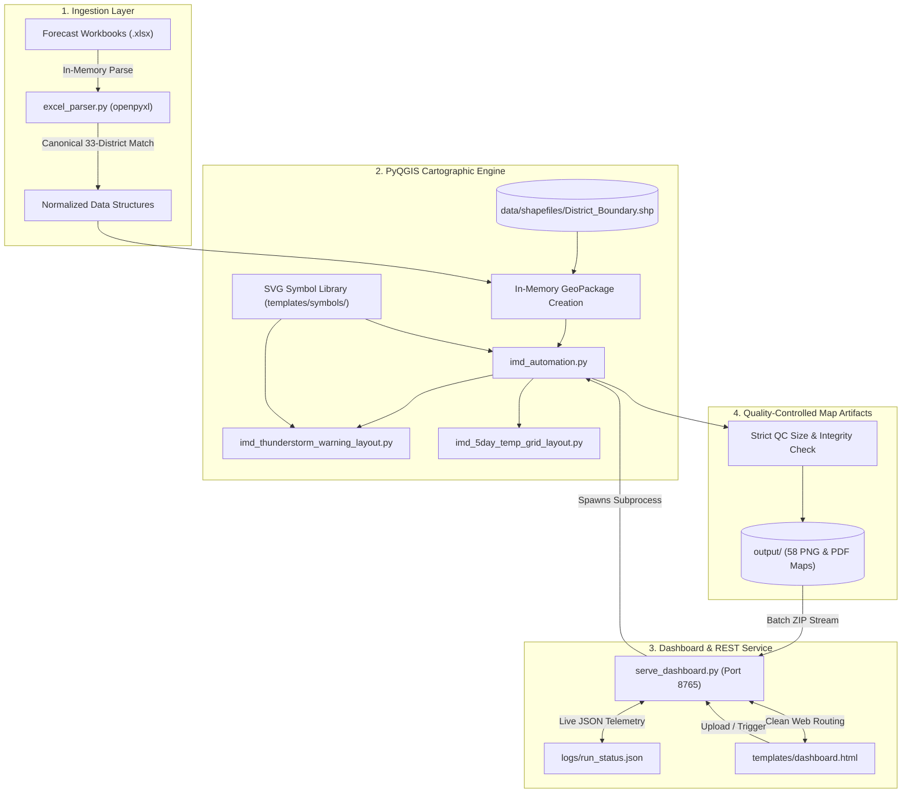

# Automated Spatial Data Processing and Thematic Map Generation in QGIS using Python
**Meteorological Centre Hyderabad — India Meteorological Department (IMD)**  
*Ministry of Earth Sciences (MoES), Government of India*

---

## 🌟 Overview

The **Automated Spatial Data Processing and Thematic Map Generation** system is an operational meteorological GIS automation platform developed for the **India Meteorological Department (IMD), Meteorological Centre Hyderabad**. 

Designed to support operational forecasters, regional disaster management authorities, and public weather dissemination channels, the platform transforms daily meteorological forecast spreadsheets into publication-grade, high-resolution geospatial thematic maps covering all 33 districts of Telangana.

The system replaces legacy manual drafting workflows and error-prone intermediate CSV translation steps with a **Direct In-Memory Excel Ingestion Engine (Zero-CSV)**, an automated **PyQGIS Cartographic Renderer**, and a **Multi-Threaded Operational Telemetry Dashboard**.

```
┌─────────────────────────────────────────────────────────────────────────────────┐
│                           END-TO-END EXECUTION FLOW                             │
├─────────────────────┬───────────────────────────┬───────────────────────────────┤
│    DATA INGESTION   │   IN-MEMORY VECTOR JOIN   │     CARTOGRAPHIC OUTPUTS      │
├─────────────────────┼───────────────────────────┼───────────────────────────────┤
│ Multi_Hazard_*.xlsx │   33 Canonical Districts  │ 58 Total High-Res Products:   │
│ SUMMER.xlsx         │   GeoPackage Attribute    │ • 7-Day Spatial Rainfall      │
│ (Direct In-Memory   │   Binding (Zero Disk CSV) │ • 5-Day Thunderstorm Warnings │
│  via openpyxl)      │   Adaptive Centroids/Anchors│ • 5-Day Rainfall Intensity   │
│                     │   Graduated Fill & Labels │ • 5-Day Max & Min Temp        │
│                     │                           │ • 5-Day Grid Summary Bulletins│
│                     │                           │   (300 DPI PNG & Vector PDF)  │
└─────────────────────┴───────────────────────────┴───────────────────────────────┘
```

---

## 🚀 Key Architectural Features

* **Direct In-Memory Excel Ingestion (Zero-CSV Engine)**:
  Ingests multi-sheet Microsoft Excel (`.xlsx`) forecast workbooks directly into Python memory buffers via `openpyxl`. Eliminates disk-bound temporary CSV files, preventing character encoding corruption, file-lock conflicts, and schema drift.
* **Intelligent 33-District Normalization**:
  Maintains a canonical dictionary and regex normalization engine covering all 33 Telangana districts. Automatically resolves spelling discrepancies, whitespace variations, and historical naming differences (e.g., *Komaram Bheem* vs. *Kumurambheem Asifabad*, *Bkothagudem* vs. *Bhadradri Kothagudem*).
* **Comprehensive 58 Thematic Map Suite**:
  Generates up to 58 publication-ready map products (29 high-resolution 300 DPI PNGs and 29 print-ready vector PDFs):
  * **7-Day Spatial Rainfall Forecast** (Days 1–7): Quantitative coverage classifications (Dry, Isolated, Scattered, Fairly Widespread, Widespread).
  * **5-Day Thunderstorm & Wind Warning** (Days 1–5): Color-coded alert levels (Nil, Watch, Alert, Warning) integrated with anchored SVG weather symbols (lightning clouds, gusty wind socks).
  * **5-Day Rainfall Intensity Warning** (Days 1–5): Multi-hazard precipitation intensity maps (Heavy Rain, Very Heavy Rain, Extremely Heavy Rain) with dynamic symbol layers.
  * **5-Day Maximum & Minimum Temperature Forecasts** (Days 1–5): Dual-series heatwave and coldwave temperature band maps.
  * **5-Day Temperature Grid Summary Bulletins**: Specialized single-page 3+2 A4 landscape grid summary layouts for Maximum and Minimum Temperature forecasts, complete with warning scales and 33-district reference directories.
* **Institutional Telemetry Dashboard & REST Service**:
  A lightweight, multi-threaded HTTP server (`serve_dashboard.py`) built strictly on the Python standard library, featuring clean URL routing (`/`), drag-and-drop workbook uploads, background execution threads, real-time polling telemetry (`/api/status`), and on-the-fly streaming ZIP downloads (`/api/download_all_png`, `/api/download_all_pdf`, `/api/download_all`).
* **Strict Quality Control (QC) Gate**:
  Every generated map undergoes post-render validation ensuring strict non-zero file sizes (>50 KB), proper aspect ratio, and 300 DPI cartographic fidelity prior to publication.

---

## 📁 Repository Structure

```
IMD_AUTOMATION_FINALL/
├── config.py                     # Central configuration single source of truth
├── serve_dashboard.py            # Multi-threaded HTTP backend with REST endpoints
├── open_dashboard.bat            # Quick launcher for web dashboard & browser
├── run_imd_automation.bat        # Command-line QGIS batch execution launcher
├── deploy_linux.sh               # Headless Ubuntu deployment script (systemd + Xvfb)
├── symbology-style.db            # SQLite symbology database for QGIS styles
├── favicon.ico / favicon.png     # Application browser icons
├── IMD_LOGO.png                  # Official IMD emblem asset
│
├── data/
│   ├── input/                    # Forecast Excel workbooks (.xlsx)
│   └── shapefiles/               # Telangana 33-district polygon shapefiles
│       ├── District_Boundary.shp # Shapefile geometry
│       ├── District_Boundary.dbf # Attribute database
│       ├── District_Boundary.prj # Coordinate Reference System (EPSG:4326)
│       └── District_Boundary.shx # Shape index
│
├── scripts/
│   ├── __init__.py
│   ├── imd_automation.py         # Main vector engine and layout orchestrator
│   ├── imd_thunderstorm_warning_layout.py # Symbology layout for thunderstorm warnings
│   └── imd_5day_temp_grid_layout.py       # 3+2 A4 landscape grid summary bulletin renderer
│
├── templates/
│   ├── dashboard.html            # Production telemetry frontend
│   ├── IMD_LOGO.png / .jpeg      # Official cartographic logo assets
│   ├── rain_cloud.svg            # Base precipitation SVG symbol
│   ├── thunderstorm_cloud.svg    # Base convective thunderstorm SVG symbol
│   └── symbols/                  # Official IMD weather icons (SVG & PNG)
│       ├── cloud_light_rain.svg
│       ├── cloud_moderate_rain.svg
│       ├── cloud_heavy_rain.svg
│       ├── cloud_extreme_rain.svg
│       ├── lightning.svg
│       ├── NorthArrow_04.svg
│       ├── thunderstorm.svg
│       ├── thunderstorm_wind.svg
│       ├── wind.svg
│       ├── windsock.svg
│       └── Wind_warning.png
│
├── utils/
│   ├── __init__.py
│   ├── excel_parser.py           # In-memory Excel data extractor & district normalizer
│   ├── atomic_json.py            # Thread-safe atomic JSON read/write routines
│   └── imd_logger.py             # Standardized operational logging framework
│
├── logs/                         # Live runtime logs and run_status.json
│   ├── automation_log.txt        # Full pipeline execution log
│   ├── run_status.json           # Live telemetry state for dashboard polling
│   └── system_health.json        # Health status report
│
└── output/                       # Generated 300 DPI PNG & vector PDF maps
```

---

## ⚡ Quick Start

### Prerequisites
1. **Windows 10 / 11 / Windows Server (64-bit)** or **Linux (Ubuntu 22.04 LTS+)**.
2. **QGIS LTR 3.x** (e.g., QGIS 3.44.14 LTR, QGIS 3.34 LTR, or OSGeo4W) with Python 3.12+ runtime.
3. Python libraries: `openpyxl` (pre-bundled with QGIS LTR).

---

### Option 1: Operational Web Dashboard (Recommended)

1. Double-click `open_dashboard.bat` (or execute from terminal):
   ```cmd
   open_dashboard.bat
   ```
2. The launcher detects the QGIS Python environment, binds to port `8765`, and opens your default browser at:
   ```
   http://localhost:8765/
   ```
3. **Usage via Web UI**:
   * Drag & drop your daily forecast workbook (`Multi_Hazard_*.xlsx` or `SUMMER.xlsx`) into the upload zone.
   * Click **Generate Rain & Warning Maps** or **Run All Maps Pipeline**.
   * Monitor the live progress bar and step indicator.
   * Preview generated maps in the modal gallery and download individual files or complete ZIP bundles.

---

### Option 2: Headless Command-Line Execution

Run the automated batch runner directly from PowerShell or Command Prompt:

```powershell
# Run the complete map suite (Rain, Thunderstorm, Intensity, Temperature, Grid Summaries)
.\run_imd_automation.bat

# Or execute via QGIS Python runner with specific module parameters:
& "C:\Program Files\QGIS 3.44.14\bin\python-qgis-ltr.bat" scripts\imd_automation.py --module=all

# Run only rainfall and warning modules:
& "C:\Program Files\QGIS 3.44.14\bin\python-qgis-ltr.bat" scripts\imd_automation.py --module=rain

# Run only summer temperature modules:
& "C:\Program Files\QGIS 3.44.14\bin\python-qgis-ltr.bat" scripts\imd_automation.py --module=summer

# Specify a custom input workbook:
& "C:\Program Files\QGIS 3.44.14\bin\python-qgis-ltr.bat" scripts\imd_automation.py --module=rain --input="data\input\Multi_Hazard_7_Day_District_Wise_Forecast_Telangana 04.09.2026.xlsx"
```

---

## 🗺️ Generated Map Product Suite

| Map Category | Forecasting Horizon | File Output Naming | Formats & DPI | Primary Cartographic Features |
| :--- | :--- | :--- | :--- | :--- |
| **7-Day Spatial Rainfall** | Days 1 to 7 | `rainfall_forecast_day1` to `day7` | PNG (300 DPI) + Vector PDF | 5-tier spatial coverage: Dry (White), Isolated (Light Green), Scattered (Dark Green), Fairly Widespread (Cyan), Widespread (Blue). |
| **5-Day Thunderstorm & Wind** | Days 1 to 5 | `thunderstorm_warning_day1` to `day5` | PNG (300 DPI) + Vector PDF | 4-tier alert scale with anchored SVG lightning/wind symbols and dual institutional advisory callouts. |
| **5-Day Rainfall Intensity** | Days 1 to 5 | `rainfall_intensity_day1` to `day5` | PNG (300 DPI) + Vector PDF | Heavy rain hazard scale: Nil, Heavy Rain, Very Heavy Rain, Extremely Heavy Rain with cloud SVG indicators. |
| **5-Day Max Temperature** | Days 1 to 5 | `tmax_day1_<DATE>` to `day5_<DATE>` | PNG (300 DPI) + Vector PDF | Heatwave risk classification: Normal (≤40°C), Be Alert (41–45°C), Be Prepared (46–47°C), Warning (>47°C). |
| **5-Day Min Temperature** | Days 1 to 5 | `tmin_day1_<DATE>` to `day5_<DATE>` | PNG (300 DPI) + Vector PDF | Coldwave risk classification: Warning (<5°C), Alert (5–10°C), Watch (11–15°C), Normal (>15°C). |
| **5-Day Grid Bulletins** | 5-Day Consolidated | `max_temp_5day_summary`<br>`min_temp_5day_summary` | PNG (300 DPI) + Vector PDF | Official 3+2 A4 landscape layout combining Days 1–5 forecast panels with warning scales and 33-district directory. |

---

## 🏛️ System Architecture Overview



---

## 📚 Complete Project Documentation

Detailed technical and operational manuals are maintained in the repository:

* 📖 **[User Manual](file:///USER_MANUAL.md)**: Comprehensive guide for forecasters, web interface operation, upload guidelines, and legend scale references.
* 🏛️ **[System Architecture Document](file:///SYSTEM_ARCHITECTURE.md)**: Deep architectural specification, layer interactions, data flow models, and component catalogues.
* 💻 **[Developer Guide](file:///DEVELOPER_GUIDE.md)**: Source code documentation, normalization routines, PyQGIS rendering mechanics, REST API endpoints, and extension guidelines.
* 🚀 **[Deployment Guide](file:///DEPLOYMENT_GUIDE.md)**: Production deployment instructions for Windows workstations, Windows Server, and headless Linux/Ubuntu servers (systemd + Xvfb).
* 📊 **[Project Report](file:///PROJECT_REPORT.md)**: Formal engineering report, problem analysis, technical solution design, performance benchmarks, and operational outcomes.

---

## 🔒 Confidentiality & Security Notice

This repository contains cartographic automation code and public layout templates developed for the India Meteorological Department. In compliance with Government of India information security practices:
* No internal network IP addresses, credentials, passwords, or restricted communication routes are committed.
* Local operational scripts should be configured using environment variables (`IMD_QGIS_ROOT`, `PORT`) or `.env`.
* When publishing or transferring this repository, ensure that runtime logs in `logs/` and generated output files in `output/` are sanitized or excluded.

---

## 👥 Authors & Institutional Credits

* **Meteorological Centre Hyderabad**, India Meteorological Department (IMD), Ministry of Earth Sciences (MoES), Government of India.
* **Development Team**:
  * **Minnekanti Sai Sree Harsha** (Project Lead & Developer)
  * **S Nyneeta Rao** (Co-Developer & GIS Cartographic Design)
  * *Academic Affiliation*: Department of Computer Science & Engineering, Geethanjali College of Engineering and Technology, Hyderabad.
