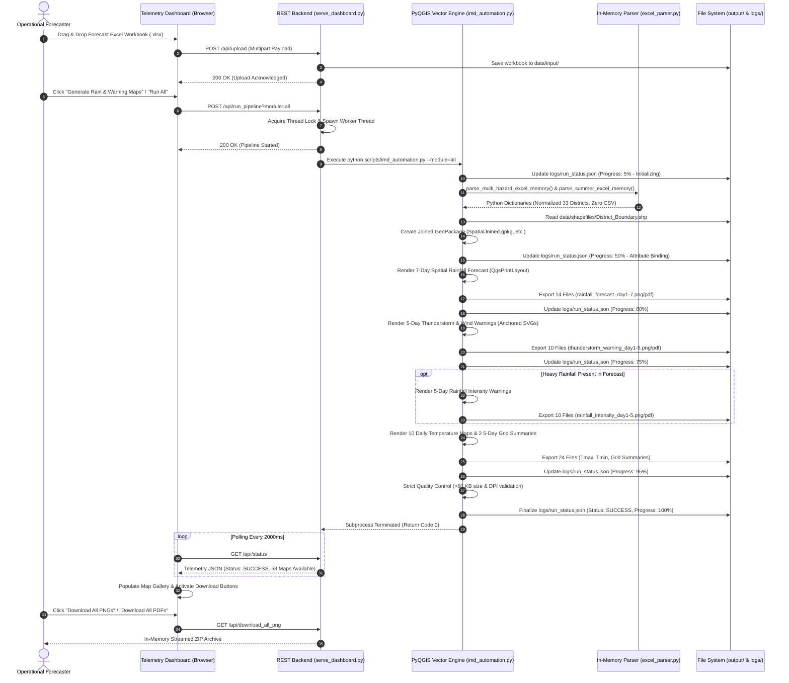

# SYSTEM ARCHITECTURE DOCUMENT: Automated Spatial Data Processing and Thematic Map Generation in QGIS using Python
**Meteorological Centre Hyderabad — India Meteorological Department (IMD)**  
*Ministry of Earth Sciences (MoES), Government of India*

---

## 1. Document Control & Executive Summary

### 1.1 Project Overview
* **System Name:** Automated Spatial Data Processing and Thematic Map Generation in QGIS using Python
* **Institutional Context:** Meteorological Centre Hyderabad, India Meteorological Department (IMD), Ministry of Earth Sciences (MoES), Government of India
* **Geographic Scope:** State of Telangana (all 33 revenue districts)
* **Version:** 2.0 (Direct In-Memory Excel Ingestion & PyQGIS Automation Engine)
* **Project Team:**
  * **Minnekanti Sai Sree Harsha** (Project Lead & System Developer)
  * **S Nyneeta Rao** (Co-Developer & Cartographic Design)
  * *Academic Institution:* Department of Computer Science & Engineering, Geethanjali College of Engineering and Technology, Hyderabad

### 1.2 Executive Summary
The **Automated Spatial Data Processing and Thematic Map Generation** platform is an operational geospatial engineering solution engineered specifically for the operational demands of the India Meteorological Department (IMD), MC Hyderabad. 

The primary objective of the system is the complete automation of daily district-wise meteorological forecast visualization. Transforming manual, labor-intensive drafting tasks into a deterministic, instantaneous execution pipeline, the platform ingests raw multi-tab Microsoft Excel (`.xlsx`) forecast workbooks, executes intelligent district name normalization, binds meteorological parameters directly into vector geometry structures in memory, and automatically renders up to 58 publication-grade thematic maps (PNG at 300 DPI and vector PDF) in under two minutes.

---

## 2. Problem Statement & Architectural Solution

### 2.1 The Operational Challenge
In regional meteorological operations, meteorologists analyze numerical weather predictions, observational feeds, and radar/satellite data to formulate daily forecasts. Historically, publishing these forecasts across public bulletins, government agencies, and disaster response units required:
1. **Manual Data Entry:** GIS operators manually entered rainfall categories, hazard alert levels, and temperature ranges district-by-district into GIS desktop projects—a process taking 45 to 60 minutes every morning and evening.
2. **Intermediate CSV Failure Modes:** Early scripting solutions attempted to convert Excel sheets into intermediate CSV files on disk. This approach introduced critical operational bottlenecks:
   * Multi-sheet workbooks caused naming collisions and required fragile disk operations.
   * Concurrent file access between the dashboard server and batch scripts triggered Windows file-locking errors (`PermissionError`).
   * Character encoding mismatches (UTF-8 vs. ANSI/CP1252) corrupted meteorological symbols and district names.
   * Floating-point precision loss and missing token delimiters distorted warning intensity levels.
3. **Cartographic Inconsistency:** Manual composition of print layouts frequently resulted in shifted scale bars, inconsistent font sizing across long district names, missing logos, or improperly aligned legends.

### 2.2 The Delivered Architectural Solution
The system establishes a **Zero-CSV Direct In-Memory Architecture**:
* **Pure In-Memory Tabular Parsing:** Microsoft Excel files (`.xlsx`) are read directly into Python memory buffers via `openpyxl`. No intermediate CSV files are written to disk.
* **GeoPackage Memory/Staging Layer:** Attributes are dynamically attached to an in-memory/staged GeoPackage layer (`SpatialJoined.gpkg`, `WarningJoined.gpkg`, etc.) using PyQGIS vector data providers, ensuring transaction safety and native spatial indexing.
* **Deterministic Layout Rendering:** PyQGIS headless printing layouts (`QgsPrintLayout`) apply fixed institutional coordinate layouts, standard IMD emblems, dynamic north arrows, anchored weather SVGs, adaptive text labeling, and graduated color ramps.
* **Non-Blocking Telemetry & Control:** A built-in multi-threaded HTTP server (`serve_dashboard.py`) coordinates worker threads, streams live progress telemetry, and generates on-the-fly ZIP packages for forecasters.

---

## 3. High-Level Architectural Design

The system is organized into four distinct architectural tiers:

```
┌─────────────────────────────────────────────────────────────────────────────────┐
│                             SYSTEM ARCHITECTURE TIERS                           │
├─────────────────────────────────────────────────────────────────────────────────┤
│  TIER 1: INGESTION & DATA NORMALIZATION                                         │
│  • utils/excel_parser.py (openpyxl in-memory workbook parser)                   │
│  • Multi-Hazard Tokenizer (TSLG3-5, HR, VHR, EHR) & Summer Temp Offset Engine   │
│  • Canonical 33-District Normalization Table & Centroid Resolution              │
├─────────────────────────────────────────────────────────────────────────────────┤
│  TIER 2: CARTOGRAPHIC RENDERING & PYQGIS VECTOR ENGINE                          │
│  • scripts/imd_automation.py (Main Vector Engine & GeoPackage Staging)          │
│  • scripts/imd_thunderstorm_warning_layout.py (Weather Symbology & Cards)       │
│  • scripts/imd_5day_temp_grid_layout.py (3+2 A4 Landscape Grid Renderer)       │
│  • templates/symbols/ (SVG & Raster Meteorological Icon Library)               │
├─────────────────────────────────────────────────────────────────────────────────┤
│  TIER 3: OPERATIONAL REST & TELEMETRY SERVICE                                   │
│  • serve_dashboard.py (Standard Library ThreadingHTTPServer on Port 8765)      │
│  • Background Thread Worker Pool with Non-Blocking State Polling               │
│  • On-The-Fly In-Memory Streaming ZIP Packager (PNG, PDF, Complete Bundles)    │
├─────────────────────────────────────────────────────────────────────────────────┤
│  TIER 4: USER PRESENTATION & MONITORING INTERFACE                               │
│  • templates/dashboard.html (Vanilla ES6 / CSS3 Dark Institutional UI)          │
│  • Live WebSockets/Polling Telemetry, Drag-and-Drop Ingestion, Modal Lightbox   │
│  • One-Click Category Filtered Map Catalogue & Batch Downloads                 │
└─────────────────────────────────────────────────────────────────────────────────┘
```

---

## 4. End-to-End System Workflow



---

## 5. Detailed Component Specifications

### 5.1 Ingestion & Normalization Engine (`utils/excel_parser.py`)
* **In-Memory Reading:** Utilizes `openpyxl.load_workbook(excel_path, data_only=True)` to parse cell values without calculating formula trees.
* **Header Auto-Detection:** Dynamically scans the first 5 rows to locate the header row by searching for keywords (`"district"`, `"day 1 forecast"`), tolerating shifting title rows.
* **District Name Normalization:**
  * Uses regex `re.sub(r"[\s\-_.,()\\']+", "", str(name)).lower()` to strip whitespace, dashes, and punctuation.
  * Matches against `CANONICAL_DISTRICTS` (exact canonical dictionary mapping 33 districts to standard names, district abbreviations, and latitude/longitude centroids).
  * Employs substring fallback against `DISTRICT_REF_TABLE` for non-standard administrative notations.
* **Multi-Hazard Token Parsing:**
  * Extracts compound forecast strings such as `"TSLG4, HR"` or `"TSLG5 / VHR"` into distinct integer warning codes.
  * Thunderstorm / Wind tokens: `TSLG5` (50–60 kmph) $\rightarrow 4$, `TSLG4` (40–50 kmph) $\rightarrow 3$, `TSLG3` (30–40 kmph) $\rightarrow 2$, Dry/Nil $\rightarrow 1$.
  * Precipitation intensity tokens: `EHR` (Extremely Heavy) $\rightarrow 4$, `VHR` (Very Heavy) $\rightarrow 3$, `HR` (Heavy) $\rightarrow 2$, No warning $\rightarrow 1$.
  * Automatically sets `has_intensity_data = True` only when heavy rainfall tokens are detected.
* **Summer Temperature Extrapolation:**
  * Scans 5 forecast days (columns 9, 14, 17, 20, 23 for forecast; columns 12, 16, 19, 22, 25 for temperature).
  * Extracts base temperature ranges via `_extract_base_temp()` and calculates microclimate district offsets using `DISTRICT_TEMP_OFFSETS` to accurately predict maximum (`tmax`) and minimum (`tmin`) temperatures.

### 5.2 Vector Cartographic Engine (`scripts/imd_automation.py`)
* **Headless QGIS Initialization:**
  Initializes `QgsApplication([], False)` and native processing algorithms (`QgsNativeAlgorithms`) without spinning up the desktop GUI.
* **GeoPackage Attribute Binding (`join_memory_data_to_shapefile`):**
  * Reads the Telangana base boundary shapefile `District_Boundary.shp`.
  * Creates an optimized, staged GeoPackage (`SpatialJoined.gpkg`, `WarningJoined.gpkg`, etc.) via `QgsVectorFileWriter`.
  * Appends integer attributes (`spatial1..7`, `warning1..5`, `inten1..5`) or double precision attributes (`tmax1..5`, `tmin1..5`).
  * Iterates vector features, binds parsed dictionary values, and commits changes atomically.
* **Cartographic Element Composition (`build_layout`):**
  * Paper Standard: A4 Landscape ($297 \times 210$ mm).
  * Standard Extent: Bounded to Telangana coordinates ($76.8293^\circ\text{E}, 15.7846^\circ\text{N}$ to $81.7245^\circ\text{E}, 19.9686^\circ\text{N}$) with an automatic 6% perimeter padding buffer.
  * Layout Elements:
    * Official IMD Emblem (`templates/IMD_LOGO.png`): $22 \times 22$ mm at $(12.0, 4.0)$ mm with department subtitle.
    * North Arrow (`NorthArrow_04.svg`): $16 \times 18$ mm at $(266.0, 4.0)$ mm with bold directional marker.
    * Title & Issue Date: Scaled typography at $(48.0, 6.0)$ mm.
    * Main Map Viewport: $215 \times 170$ mm at $(10.0, 24.0)$ mm.
    * Legend / Scale Block: $58 \times 100$ mm at $(230.0, 55.0)$ mm.
    * Institutional Footer: $(5.0, 204.0, 287.0, 5.0)$ mm with contact info and official web portal URL.
* **Dynamic Label Placement:**
  * Uses `QgsPalLayerSettings` with centroid-inside placement.
  * Implements SQL expression-based adaptive font sizing: reduces point size for long district names (e.g., *Jayashankar Bhupalpally*, *Kumurambheem Asifabad*) and compact districts (*Hyderabad*, *Hanumakonda*) to completely eliminate text collisions.
  * Enforces white halo text buffers ($0.85$ mm to $1.20$ mm) ensuring high contrast against dark or saturated thematic fills.

### 5.3 Specialized Thunderstorm Layout Engine (`scripts/imd_thunderstorm_warning_layout.py`)
* **Weather Symbology Injection:**
  * Creates a temporary point vector layer (`Point?crs=EPSG:4326`) populated with anchored coordinates from `DISTRICT_ANCHORS`.
  * Uses `QgsSvgMarkerSymbolLayer` and `QgsRasterMarkerSymbolLayer` to place weather icons:
    * `windsock.svg` / `Wind_warning.png` for wind warnings.
    * `cloud.png` / `thunderstorm_wind.svg` for convective thunderstorm with wind.
    * `thunderstorm.svg` for standard convective storm activity.
  * If a manual anchor is undefined, falls back to `geom.poleOfInaccessibility(0.002)` ensuring icons always remain inside district borders.
* **Institutional Warning Callouts:**
  Adds dedicated advisory legend cards:
  * Green Box: *"Strong/Sustained surface wind with speed reaching 30-40 kmph"*.
  * Yellow Box: *"Light Thunderstorm accompanied with Lightning with Max surface wind speed 30-40 kmph"*.

### 5.4 5-Day Temperature Grid Summary Layout Engine (`scripts/imd_5day_temp_grid_layout.py`)
* **6-Cell Landscape Architecture:**
  * Organizes five independent map viewports (Days 1 to 5) into a balanced $3 \times 2$ grid layout.
  * Cells 1–5: Individual day cards ($89 \times 78$ mm) each displaying Telangana district outlines themed by temperature bands with district abbreviation labels.
  * Cell 6 (Bottom-Right Panel): Dedicated reference panel containing:
    1. Warning Scale Legend: Heatwave scale (for Tmax) or Coldwave scale (for Tmin) with color swatches and temperature thresholds.
    2. Telangana Districts Directory: Comprehensive 3-column reference table listing all 33 district three-letter abbreviations alongside full district names (e.g., `ADL: Adilabad`, `HYD: Hyderabad`, `WRGR: Warangal`).

### 5.5 Backend Telemetry & REST Server (`serve_dashboard.py`)
* **Zero External Web Framework Dependencies:**
  Constructed entirely using Python's standard library `http.server.ThreadingHTTPServer` and `SimpleHTTPRequestHandler`. Operates immediately in air-gapped government environments without requiring `pip install flask` or `fastapi`.
* **Clean URL Routing:**
  Serves the operational dashboard directly on the root path `http://localhost:8765/`. Automatically redirects `/templates/dashboard.html` to root with a `302 Found` header.
* **REST Endpoints:**
  * `GET /api/status`: Returns JSON telemetry encompassing pipeline running status, current execution step, progress percentage (0–100%), input workbook status, and categorized map product catalogue.
  * `POST /api/upload`: Handles multipart form data uploads, validates `.xlsx` file extensions, and writes files directly to `data/input/`.
  * `POST /api/delete_workbook?file=...`: Safely removes stale forecast workbooks.
  * `POST /api/parse_excel`: Verifies in-memory parsing capability across input files without triggering map generation.
  * `POST /api/run_pipeline?module=...`: Launches background generation threads (`rain`, `summer`, or `all`).
  * `GET /api/download_all_png` / `GET /api/download_all_pdf` / `GET /api/download_all`: Dynamically constructs in-memory ZIP archives using `zipfile.ZipFile(buf, "w")` and streams binary archives directly to the client browser.

---

## 6. Official Cartographic Scales & Symbology Reference

### 6.1 7-Day Spatial Rainfall Forecast Scale
Represents the spatial coverage of precipitation across district area:

| Code | Classification | Category Label | Area Coverage | Official Hex Color | RGB Color |
| :---: | :---: | :--- | :---: | :---: | :---: |
| **1** | **Dry** | Dry (No Rain) | 0% | `#FFFFFF` | `255, 255, 255` |
| **2** | **ISOL** | One or two places (Isolated) | 1–25% | `#6BEA48` | `107, 234, 72` |
| **3** | **SCT** | Few places (Scattered) | 26–50% | `#0A7A32` | `10, 122, 50` |
| **4** | **FWS** | Many places (Fairly Widespread) | 51–75% | `#56ACE6` | `86, 172, 230` |
| **5** | **WS** | Most places (Widespread) | 76–100% | `#2E73D8` | `46, 115, 216` |

### 6.2 5-Day Multi-Hazard Warning Alert Levels
Represents the administrative response level and risk severity:

| Warning Code | Alert Stage | Official Legend Label | Action Guidance | Hex Color | Symbology Applied |
| :---: | :--- | :--- | :--- | :---: | :--- |
| **1** | **Nil** | No warning | No action required | `#009900` | None |
| **2** | **Watch** | Watch (Be updated) | Monitor localized updates | `#FFFF00` | Windsock / Wind warning |
| **3** | **Alert** | Alert (Be prepared) | Prepare for severe conditions | `#FF9900` | Convective storm + wind |
| **4** | **Warning** | Warning (Take action) | Initiate emergency response | `#FF0000` | Squall / severe storm |

### 6.3 5-Day Rainfall Intensity Scale
Applied when localized heavy precipitation tokens are present:

| Intensity Token | Classification | Operational Range | Applied Hex Fill | SVG Symbol Overlay |
| :---: | :--- | :---: | :---: | :--- |
| **-** | **Light to moderate** | $0.1 - 64.4$ mm | `#009900` | `cloud_light_rain.svg` |
| **HR** | **Heavy rain** | $64.5 - 115.5$ mm | `#FFFF00` | `cloud_moderate_rain.svg` |
| **VHR** | **Very heavy rain** | $115.6 - 204.4$ mm | `#FF9900` | `cloud_heavy_rain.svg` |
| **EHR** | **Extremely heavy rain** | $> 204.4$ mm | `#FF0000` | `cloud_extreme_rain.svg` |

### 6.4 Temperature Forecast Warning Scales

#### Maximum Temperature (Heatwave Scale - Tmax)
* `[#2E7D32]` **No Warning** ($\le 40.0^\circ\text{C}$): Normal summer range.
* `[#FFD54F]` / `[#FFFF00]` **Be Alert** ($41.0 - 45.0^\circ\text{C}$): Moderate heat stress.
* `[#FB8C00]` / `[#FF8000]` **Be Prepared** ($45.1 - 47.0^\circ\text{C}$): Severe heatwave warning.
* `[#D32F2F]` / `[#FF0000]` **Warning** ($> 47.0^\circ\text{C}$): Extreme heat emergency.

#### Minimum Temperature (Coldwave Scale - Tmin)
* `[#D32F2F]` / `[#FF0000]` **Warning** ($< 5.0^\circ\text{C}$): Severe coldwave emergency.
* `[#FB8C00]` / `[#FF8000]` **Alert** ($5.0 - 10.9^\circ\text{C}$): Coldwave alert.
* `[#FFD54F]` / `[#FFFF00]` **Watch** ($11.0 - 15.9^\circ\text{C}$): Cold day advisory.
* `[#2E7D32]` / `[#008000]` **No Warning** ($\ge 16.0^\circ\text{C}$): Normal night temperatures.

---

## 7. Data Storage, Schemas & File Models

### 7.1 District Shapefile Attribute Schema (`District_Boundary.shp`)
* Geometry: `MultiPolygon`
* CRS: `EPSG:4326` (WGS 84 Geographic Coordinates)
* Primary Join Field: `Dist_Name` (String, length 50)
* Canonical Features: Exactly 33 district records.

### 7.2 Staged GeoPackage Schema (`*Joined.gpkg`)
* Driver: `GPKG` (OGC GeoPackage)
* Layer: `districts`
* Dynamic Fields:
  * Spatial: `spatial1` to `spatial7` (`Integer`)
  * Thunderstorm: `warning1` to `warning5`, `tslg1` to `tslg5` (`Integer`)
  * Rainfall Intensity: `inten1` to `inten5` (`Integer`)
  * Summer Temperature: `tmax1` to `tmax5`, `tmin1` to `tmin5` (`Double`)

### 7.3 Telemetry JSON Schema (`logs/run_status.json`)
```json
{
  "status": "SUCCESS",
  "module": "all",
  "progress": 100,
  "step": "Completed Successfully",
  "last_run": "08-11-2026 18:44:52",
  "end_time": "08-11-2026 18:46:43",
  "maps_generated": 58,
  "is_estimated": false,
  "mode": "PROD",
  "errors": [],
  "date": "08-11-2026",
  "start": "2026-11-08T18:44:52.124567",
  "end": "2026-11-08T18:46:43.890123",
  "elapsed_s": 111,
  "png_count": 29
}
```

---

## 8. Reliability, Concurrency & Error Recovery

1. **Thread Synchronization:**
   The dashboard backend utilizes a re-entrant `threading.Lock()` (`_PIPELINE_LOCK`). If an operator clicks a generation button while a background run is underway, the server rejects the request with an HTTP 200 payload indicating that execution is already active.
2. **Atomic State Persistence:**
   Telemetry and log updates are written using `utils.atomic_json.atomic_write_json()`. The function writes to `<file>.tmp`, invokes `os.fsync()` to ensure disk flush, and executes an atomic `os.replace()`, preventing corrupt JSON reads by the frontend during high-frequency polling.
3. **QGIS Garbage Collection & Project Cleansing:**
   Between render passes, `scripts/imd_automation.py` explicitly invokes `project.clear()`, detaches data providers, and forces Python garbage collection (`gc.collect()`). This releases vector layer locks on GeoPackage tables and prevents memory expansion during bulk rendering.
4. **Strict Post-Render Quality Assurance:**
   The output engine invokes `quality_check_output_strict()` on every generated PNG and PDF. If any file is missing or its size falls below 50 KB (indicating an empty canvas or crashed layout), the engine records the fault, flags `system_health.json`, and halts the pipeline with an informative error stack.
